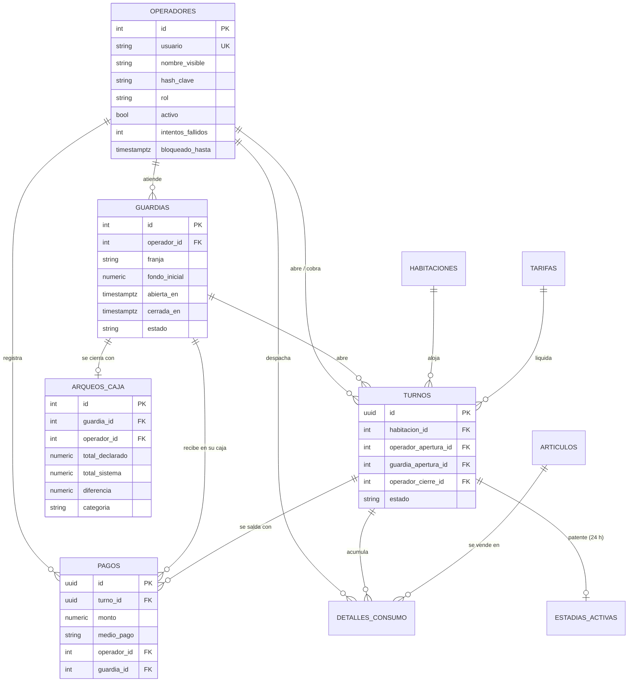

# Arquitectura del prototipo v2 · decisiones, modelo de datos y seguridad

Versión 1 · 19/10/2026 (redactado desde el 12/10/2026 y actualizado con el acta de la gerencia del 19/10/2026) · Thiago Martino Leal · Insumo de los Capítulos VI y IX (AE3)

## 1. Modelo de datos del v2

| Entidad | Regla en la base | Requisito |
| :--- | :--- | :--- |
| Operador | Usuario único y con formato; solo el dueño de las tablas da de alta, cambia roles o claves | RNF-04 |
| Guardia | Una sola abierta (índice único parcial); cerrada solo con su arqueo; cerrada no cambia ni se borra | RF-08, RN-RES-02 |
| Arqueo_Caja | Uno por guardia; la base calcula el total del sistema, la diferencia y la categoría; no admite UPDATE ni DELETE | RF-08, RF-09, RN-DER-03, RN-RES-02 |
| Pago | Solo en la guardia abierta, a nombre de su operador y sobre un turno en curso | RN-DER-04, RNF-04 |
| Turno | Atribuido a operador y guardia (restricción `NOT VALID`: los turnos de la v1 no se reescriben) | RNF-04 |

## 2. Decisiones de arquitectura

### ADR-03 · Sesión con JWT en cookie httpOnly
- **Contexto:** RNF-04 exige que el token no sea visible desde `document.cookie` y que cada operación quede a nombre de quien la hace. Hay una sola PC en la ventanilla, compartida por tres conserjes en guardias de 8 h.
- **Decisión:** JWT firmado con HS256, en una cookie `httpOnly`, `SameSite=Strict` y `Secure` en producción, válido 9 h. Claves con argon2id. Bloqueo de 15 min tras 5 intentos fallidos.
- **Alternativas descartadas:** guardar el token en `localStorage`, que cualquier script de la página puede leer; sesiones en la base, que agregan una tabla y una consulta por petición sin necesidad para un solo servidor; OAuth o un proveedor externo, desproporcionado para tres usuarios y dependiente de internet.
- **Consecuencia:** al usar cookies hay que protegerse de CSRF. Se combina `SameSite=Strict`, CORS con orígenes fijos y un encabezado propio (`X-Requested-With: motelos`) que un formulario de otro sitio no puede enviar.

### ADR-04 · Cierre ciego por guardia con la base como autoridad del total
- **Contexto:** RN-RES-03 prohíbe mostrar el total antes del recuento; RF-09 necesita una diferencia confiable para evaluar a cada conserje.
- **Decisión:** el total del sistema no se calcula en ninguna consulta de una guardia abierta. Se calcula al confirmar, en la misma transacción que guarda el arqueo y cierra la guardia. En PostgreSQL lo recalcula un trigger con los pagos de la guardia, así que la aplicación no puede guardar un total falso aunque tenga un error.
- **Alternativa descartada:** calcular el total solo en la aplicación. Una falla o una alteración del backend podría registrar un arqueo «Correcto» que no lo es.

### ADR-05 · Imputación del cobro a la guardia que atiende (RN-DER-04)
- **Contexto:** un turno abierto a las 21:30 por la guardia de las 14:00 se cobra a las 23:30.
- **Decisión:** el pago se imputa a la guardia **abierta en la ventanilla** cuando se registra el cobro. El efectivo cae en la gaveta de quien atiende, y esa es la caja que se cuenta. La apertura queda atribuida en el turno a quien lo abrió.
- **Validación:** la gerencia aprobó el 19/10/2026 la redacción nueva de RN-DER-04: «El cobro se imputa a la caja del conserje que lo confirma, aunque el turno lo haya abierto otro conserje u otra guardia». Con un solo responsable por guardia, esa caja es la de la guardia abierta en la ventanilla.

## 3. Qué garantiza cada mecanismo (Bloque B, punto 1)

| Mecanismo | Qué garantiza | Frente a quién | Dónde está en el v2 |
| :--- | :--- | :--- | :--- |
| **Trigger** | Que ninguna sentencia, venga de donde venga, modifique un turno cerrado, un pago, un arqueo o una guardia cerrada, y que la base calcule el total del arqueo | Frente a cualquier usuario que no pueda deshabilitar triggers: la aplicación, un error de código, una inyección SQL | `check_turno_inmutable`, `check_pago_append_only`, `check_consumo_inmutable`, `check_arqueo_inmutable`, `check_guardia`, `calcular_arqueo`, `check_pago_en_guardia_abierta` |
| **Permiso** (`GRANT`, por tabla y por columna) | Que el rol de la aplicación no pueda deshabilitar triggers, alterar tablas, crear operadores, cambiar roles o claves, borrar pagos ni tocar arqueos | Frente a la aplicación comprometida: aunque alguien ejecute SQL con su conexión, no escala privilegios ni apaga los triggers | Migración 002, sección de permisos; verificado por `verify_roles.sql` |
| **RLS** (Row-Level Security) | Qué **filas** puede ver o modificar cada rol de base de datos. No vuelve nada inmutable | Frente a roles de base distintos que comparten tablas (por ejemplo, varios establecimientos) | **No se usa.** La aplicación entra con un único rol de base; la separación por usuario la hacen el token y la autorización de cada ruta. Una política `USING (true)` no filtraría nada |

**Riesgo residual:** el dueño de las tablas (`postgres`), que aplica las migraciones, sí puede deshabilitar un trigger. Su clave no está en la aplicación, ni siquiera en el contenedor de la API: la tiene solo el servicio `admin`, que no corre con el sistema.

## 4. Amenazas, controles y verificación

| Amenaza | Control | Verificación |
| :--- | :--- | :--- |
| Uso sin identificarse | Toda ruta de `/api` exige sesión | `test_toda_ruta_de_la_api_exige_sesion` (recorre el esquema OpenAPI) |
| Robo del token desde el navegador | Cookie `httpOnly` y `SameSite=Strict` | `test_login_correcto_entrega_cookie_httponly_y_strict`; en el navegador, `document.cookie` vacío |
| Petición falsificada entre sitios | Encabezado propio obligatorio y CORS con orígenes fijos | `test_peticion_que_modifica_sin_el_encabezado_de_la_app_responde_403` |
| Adivinar claves | argon2id, bloqueo 5/15 min, mismo mensaje y mismo tiempo de respuesta | `test_bloqueo_tras_cinco_intentos_fallidos` y siguientes |
| Token adulterado, vencido o con otro rol | Firma y vencimiento obligatorios; el rol se compara con la base | `test_token_adulterado_o_vencido_responde_401`, `test_token_con_otro_rol...` |
| Operar a nombre de otro | El operador sale del token; la base exige que el pago lo registre el operador de la guardia | `test_turno_consumo_y_cobro_quedan_a_nombre...`; `verify_caja.sql` |
| Ver el total antes del recuento | Ninguna ruta lo calcula para una guardia abierta; el panel es solo de la gerencia | `test_rf_08_ninguna_respuesta_muestra_el_total_antes_del_recuento` |
| Alterar un arqueo o meter un pago después | Triggers de RN-RES-02 | `verify_caja.sql` en el canal |
| Escalar privilegios desde la aplicación | Permisos por columna del rol `motel_app` | `verify_roles.sql` en el canal |
| Dependencias vulnerables | `pip-audit` y `npm audit` de producción en el canal | Paso del canal |
| Exponer la base a la red | Puertos publicados solo en `127.0.0.1` | `docker-compose.yml` |

## 5. Evidencia de RNF-02 (latencia)

Medición local del 19/10/2026, 23:01 h, contra la API en Docker con el rol `motel_app` y las dependencias del v2: 200 peticiones (5 aperturas y 5 cobros concurrentes, 20 repeticiones), ninguna con error. Percentil 95: apertura 127,6 ms; cobro 149,1 ms; total 146,9 ms, frente al umbral de 800 ms. El detalle está en `20261019_Medicion_latencia_RNF-02.csv`, en esta misma carpeta. El canal repite la medición en cada corrida y la guarda como artefacto; en la corrida del 19/10/2026 (etapa 6) el P95 total fue de 34,6 ms.

## 6. Validación con la gerencia (acta del 19/10/2026)

La gerente (Rosa C.) firmó el acta de validación de las decisiones del v2 el 19/10/2026, a las 16:00 h. El original escaneado está en el Portafolio (no en el repositorio).

| Punto | Decisión de la gerencia | Efecto en el v2 |
| :--- | :--- | :--- |
| 1 · Varios conserjes en la misma franja | **Uno solo**: «solo 1 responsable por turno» | Se mantiene una sola guardia abierta por ventanilla, con un responsable |
| 2 · Confirmar cada cobro con PIN | Observado: «un usuario por turno» | No se implementa: todas las operaciones de la guardia van al responsable |
| 3 · Usuarios y roles | Aprobado; **la gerencia** da de alta y de baja a los conserjes | Sin cambios: el alta la hace la gerencia con el script de administración (usuario dueño) |
| 4 · Bloqueo y sesión (5 intentos, 15 min, 9 h) | Aprobado | Sin cambios |
| 5 · Fondo de cambio | **$25.000 por caja** | `FONDO_INICIAL_CAJA = 25000` |
| 6 · Cierre ciego | Observado: «se coloca el monto total». El conserje **ve su diferencia** | El efectivo se declara como monto total, sin desglose por billete |
| 7 · Turno que pasa por varias manos | Aprobado | Sin cambios (ADR-05) |
| 8 · Control de la gerencia | Aprobado | Sin cambios |
| 9 · Caja abandonada | Aprobado | Sin cambios (ADR-06) |
| RF-08 modificado (cierre por conserje) | **No aprobado**: «solo 1 conserje» | RF-08 conserva su redacción original (cierre al final de cada guardia de 8 h) |
| RF-14 nuevo (cierre supervisado) | Aprobado | Requisito nuevo validado |
| RNF-04 ampliado (PIN por cobro) | **No aprobado** | RNF-04 conserva su redacción original |
| RN-DER-04 modificada | Aprobada | Redacción nueva validada (ADR-05) |

### ADR-06 · Cierre supervisado de una guardia abandonada
- **Contexto:** con una sola guardia abierta por ventanilla, un conserje que se va sin arquear bloquea al siguiente.
- **Decisión:** la gerencia cuenta la gaveta y confirma el arqueo en su lugar, también a ciegas, con un motivo obligatorio. El arqueo sigue siendo de la caja del conserje (`operador_id`) y registra quién lo confirmó (`confirmado_por_id`) y por qué (`observacion`). La base admite como confirmante solo al operador de la guardia o a un `ADMINISTRADOR`, y exige el motivo en ese caso (migración 003).
- **Alternativa descartada:** que el conserje entrante cuente la caja del saliente. Mezclaría responsabilidades y le daría al entrante un incentivo para «encontrar» un faltante ajeno.
